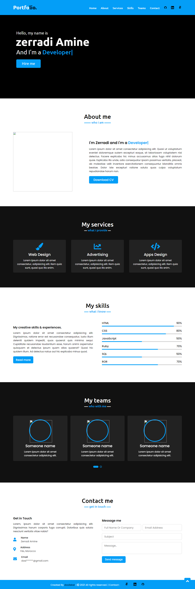

## Portfiolio 

- in this Project for the Portfolio assesement

## built with

- HTML && CSS && BOOTSRTAP
- LINTERS &  HINTRC

# Screenshot of the page

## Live demo link 

- <a href="https://zerradi.web.app/">Live Demo Link</a>

## Author 

- @Zerradi Amine (github) : (www.github.com/dasileker)

## License

- this Project is MIT license

## Feedback

- if you have any question please open an issue

## support 
 
 -  give a star ⭐ if you like it

 ## License

 - MIT 1.0.2 

## Local config

- Copy `.env.example` to `.env` and fill in your Firebase and email values.
- Run `npm run generate-config` before opening or deploying the site.
- This creates `public/config.js`, which is ignored by git.
- Important: this removes keys from the repository, but values used in browser code are still visible in the client. For real secret handling, move email sending and any privileged operations to a backend or serverless function.

